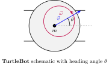
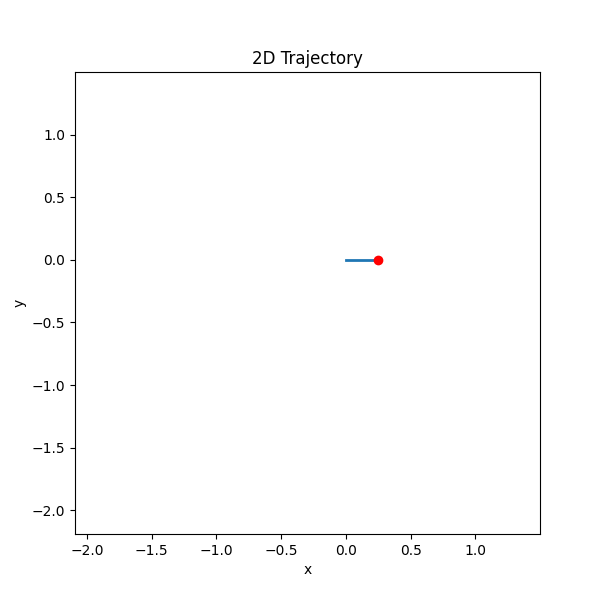
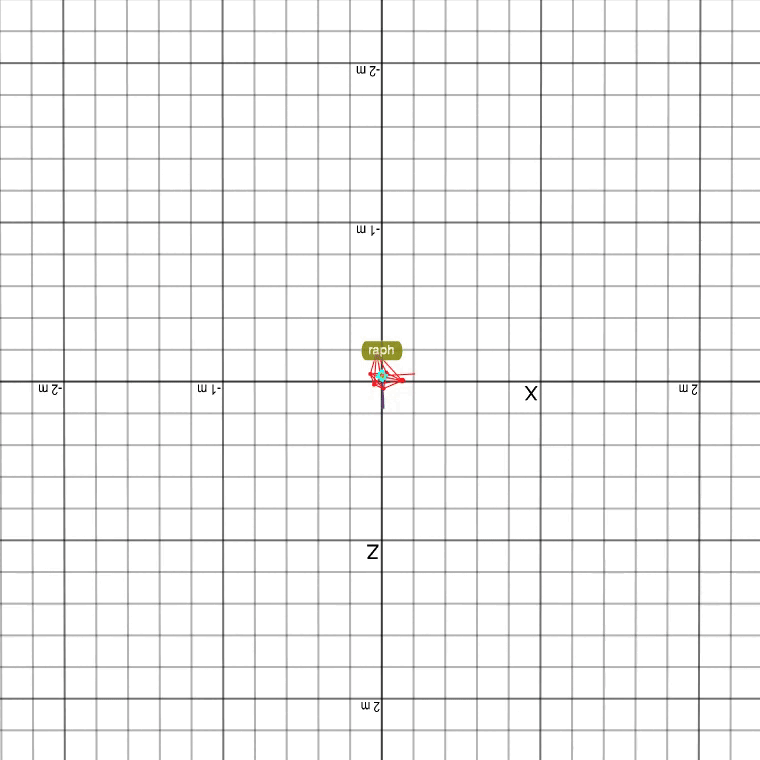

# dynamicalnodes: Control Systems in ROS 2

> _"Give me a [control system] long enough and a [computer] on which to place it, and I shall move the world."_ - Archimedes 

**dynamicalnodes** is a Python development framework that bridges the gap between novel control systems and their implementation onto ROS 2. Designed for hobbyists, students, and academics alike, this framework won't cure cancer, but it can do the next best thing: make robotics easier.

To get started, or to explore what this framework has to offer, click here: [dynamicalnodes Documentation](https://nehalsinghmangat.github.io/dynamicalnodes).

For a cute 22-second video I made to describe this framework's intended workflow for, click here: [SAIL 2025 -- Presenting dynamicalnodes](https://youtu.be/5GbVHo6QZrw).

---
## Turtlebot: Whiteboard ⟶ Python ⟶ ROS 2 ⟶ World
<table>
  <tr>
    <td align="center">
       
    </td>
    <td align="center">
       
    </td>
    <td align="center">
       
    </td>
    <td align="center">
       
    </td>
  </tr>
</table>

  

---

## What will this package do that LLMs won't?
When this package was first being written, LLMs were still in their infancy. They have now advanced to the point where anyone, armed only with tokens and patience, can probably implement a custom control algorithm within ROS. 

So why use **dynamicalnodes**? Because this package leverages the theory of discrete-time dynamical systems to create a one-to-one mapping between control diagrams and ROS node graphs. This is huge. Why? Because such a correspondence not only helps us mere mortals reason about live control systems in ROS, it also helps *LLMs* reason about them. Pairing this package with your LLM of choice is a dangerous combination, and I dare say it would make the enterprising user all but invincible. 

This repo contains skill.md files (described below) that can give context to LLMs and help you use this package with minimal effort.

## Agent skills for writing code with dynamicalnodes

The repo ships [Claude Code skills](https://docs.claude.com/en/docs/claude-code/skills) in [`.claude/skills/`](.claude/skills) that walk an AI coding assistant (and you) through the workflow step by step. Each skill is a short, checked procedure with a runnable example and a list of common mistakes. They follow the same four steps as the tutorial:

| Skill | Use it to |
|---|---|
| [`discretize-f-h`](.claude/skills/discretize-f-h/SKILL.md) | Turn continuous-time `f` and `h` (ODEs, `A`/`B`/`C` matrices) into discrete-time Python `f` and `h` |
| [`simulate-with-dynamicalsystem`](.claude/skills/simulate-with-dynamicalsystem/SKILL.md) | Write the Python for-loop for `DynamicalSystem` blocks, including feedback loops and estimators |
| [`wrap-in-rosnode`](.claude/skills/wrap-in-rosnode/SKILL.md) | Create `ROSNode` objects (topics, message types, converters) and re-run the loop on ROS types |
| [`write-ros-converters`](.claude/skills/write-ros-converters/SKILL.md) | Write a `ros2py_*` / `py2ros_*` pair for a message type the package doesn't cover |
| [`deploy-rosnodes-to-rclpy`](.claude/skills/deploy-rosnodes-to-rclpy/SKILL.md) | Generate, run and debug the `rclpy` files (`sync_mode`, `timer_hz`, `stale_after`, parameters) |

**Using them.** Clone this repository and open it with Claude Code: the skills in `.claude/skills/` are picked up automatically. To use them in your own project, copy the folders you want into your project's `.claude/skills/` (or into `~/.claude/skills/` for all projects). They are not part of the `pip` package. The [tutorial notebook](https://nehalsinghmangat.github.io/dynamicalnodes/tutorials/0_cruise_control/cruise_control_with_dynamicalnodes.html) points to the relevant skill at each step. The [`CLAUDE.md`](CLAUDE.md) file describes the package semantics those skills rely on.

